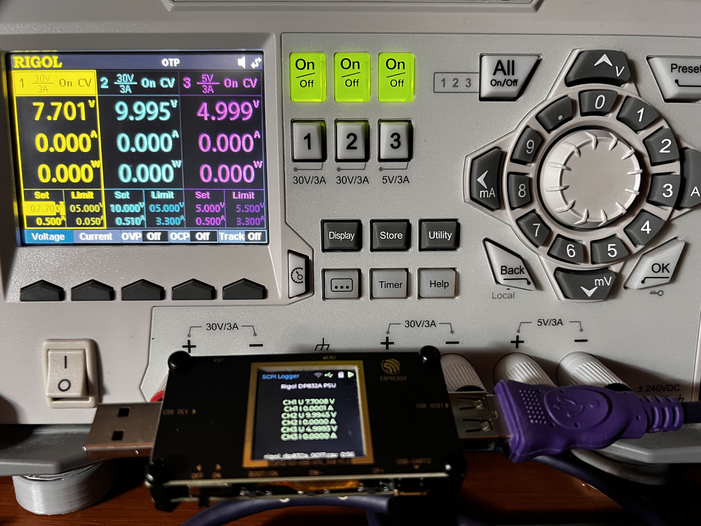
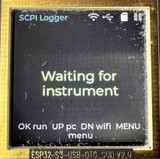
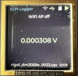
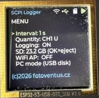
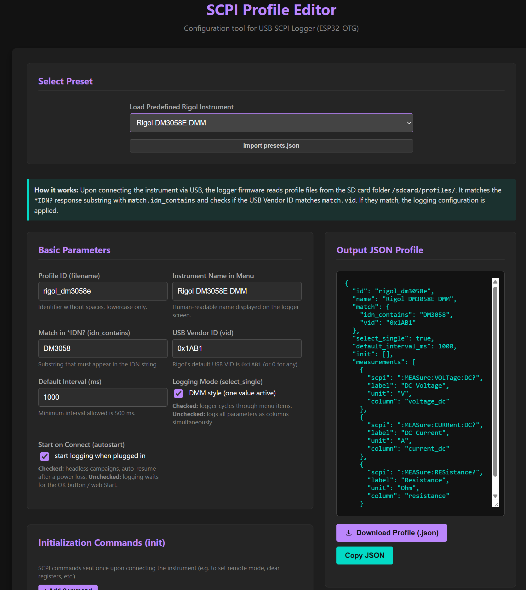
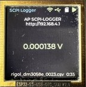
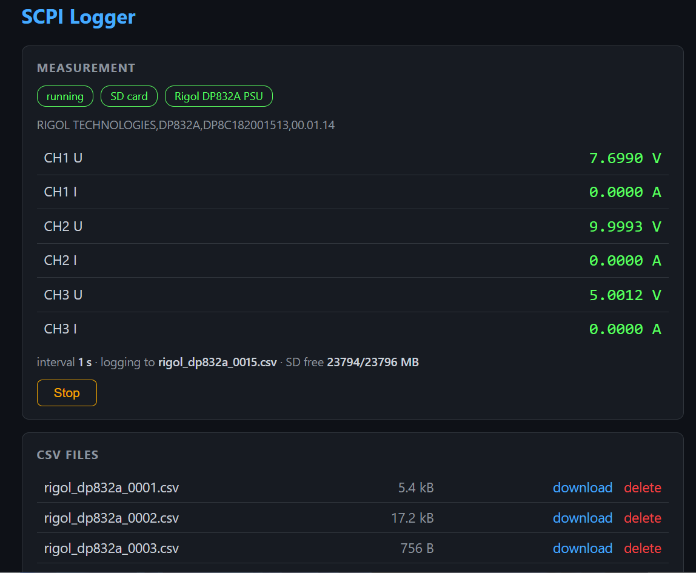
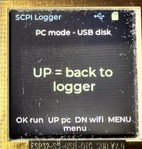
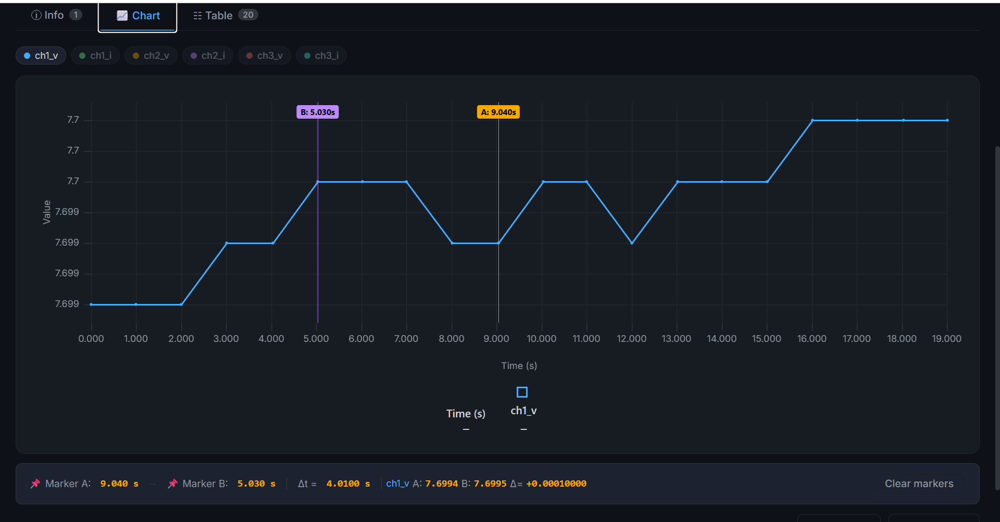

# SCPI Logger

A standalone data logger for SCPI measurement instruments (USBTMC over USB), built on the
**[Espressif ESP32-S3-USB-OTG](https://docs.espressif.com/projects/esp-dev-kits/en/latest/esp32s3/esp32-s3-usb-otg/user_guide.html)** dev kit. This repository is the **proof-of-concept /
verification series** of the project.

This project gave rise to the **[BenchLogger application](https://fotoventus.cz/benchlogger/)**.

Plug an instrument into the USB host port, and the kit identifies it (`*IDN?`), picks a
matching **profile**, and starts logging readings to CSV files on the SD card. No PC needed —
but when you want one, the kit can turn into a USB card reader or bring up its own WiFi
access point with a web interface.

<a href="imgs/IMG_6486.jpeg">
  
</a>
<br>
<sub>click to enlarge</sub>

## What it does

- **USBTMC/SCPI instruments** on the USB host port (Full-Speed). Verified with
  Rigol **DM3058E** (DMM) and Rigol **DP832A** (power supply); any SCPI instrument
  can be added with a JSON profile — no reflashing.
- **Instrument auto-detection**: after enumeration the kit reads `*IDN?` and selects a
  profile by IDN substring and/or USB VID.
- **CSV logging to SD card** with relative timestamps, metadata header, periodic `fsync`
  (a power loss costs at most a few samples) and automatic file rotation at 10 MB.
- **Multi-channel instruments**: a profile can define several measurements — one CSV row
  holds all of them as columns (e.g. DP832A: U and I of all three channels).
- **Live display** (ST7789 LCD): current reading(s), instrument/profile name, status icon
  bar, name of the CSV being written and the elapsed recording time.
- **PC mode**: the kit reboots into a USB Mass Storage device and exposes the SD card to
  your PC as a removable disk — grab the CSVs, edit profiles, done.
- **WiFi Soft AP + web interface** (on demand): live status, start/stop, CSV download and
  delete, profile upload/download/delete. AP only — the kit never joins your network.
- **Safe SD handling**: eject/mount from the menu, so the card can be removed (or power
  switched off) without corrupting the filesystem.

## Hardware

| | |
|---|---|
| Board | Espressif **ESP32-S3-USB-OTG** (module ESP32-S3-MINI-1-N8, 8 MB flash, no PSRAM) |
| Framework | ESP-IDF v5.5 |
| Display | ST7789 240×240 (LVGL 9) |
| Instrument port | USB HOST connector (Type-A female), VBUS switched by firmware |
| Power / PC port | USB DEV connector (Type-A male) — powers the board and serves PC mode |

> The USB HOST port cannot be powered from the debug micro-USB — power the board through
> the USB DEV connector (or from the Li-ion battery with the boost converter).

## Display and buttons




The **Live screen** shows the current reading (big font; multi-channel instruments show all
channels stacked), the matched profile name, and at the bottom the CSV file being written
together with the elapsed recording time (`rigol_dp832a_0003.csv  1:23:45`).

The **icon bar** (top right, always visible):

| Icon | Meaning |
|---|---|
| ▶ / ⏸ | logging runs (green) / paused (orange) / no instrument (grey) |
| SD | card mounted (white) / missing or ejected (red) |
| USB | instrument connected (green) / PC mode (blue) |
| WiFi | access point running (green) / off (grey) |

Buttons on the Live screen act directly:

| Button | Action |
|---|---|
| **OK** | start / stop logging |
| **UP** | switch to PC mode (USB disk) |
| **DOWN** | WiFi access point on / off |
| **MENU** | open the menu |

## Menu



`UP`/`DOWN` moves the green cursor, `OK` activates, `MENU` returns to Live.

| Item | Action on OK |
|---|---|
| **Interval** | cycle the sampling interval (0.5 / 1 / 2 / 5 / 10 s) |
| **Quantity** | DMM: switch the measured function (starts a new CSV); multi-channel: pick the channel shown on Live |
| **Logging** | start / stop logging |
| **SD** | shows free space; safe-eject or re-mount the card |
| **WiFi AP** | access point on / off |
| **PC mode** | become a USB disk for the PC |

## Profiles — one firmware, many instruments

An instrument is described by a **JSON profile**, not by code: which SCPI queries to send,
how to name the CSV columns, the default interval, init commands sent on connect, and how
the instrument behaves:

```json
{
  "id": "rigol_dp832a",
  "name": "Rigol DP832A PSU",
  "match": { "idn_contains": "DP832", "vid": "0x1AB1" },
  "select_single": false,
  "autostart": true,
  "default_interval_ms": 1000,
  "init": [],
  "measurements": [
    { "scpi": ":MEASure:VOLTage? CH1", "label": "CH1 U", "unit": "V", "column": "ch1_v" },
    { "scpi": ":MEASure:CURRent? CH1", "label": "CH1 I", "unit": "A", "column": "ch1_i" }
  ]
}
```

- `select_single: true` = DMM style, one measurement logged at a time (the menu switches
  between them); `false` = all measurements become columns of every CSV row.
- `autostart: false` = logging waits for the OK button / web Start (clean data for
  hand-operated instruments); `true` = logging starts right on connect and auto-resumes
  after a power loss (unattended campaigns).

Profiles are loaded from the **`/profiles` directory of the SD card** and take precedence
over the firmware built-ins (DM3058E, DP832A) — shown in **yellow** on the display so you
can tell. Copy a JSON to the card (PC mode makes that trivial, or upload it over WiFi) and
the kit supports a new instrument without touching the firmware.

Profiles are created with the **configurator**: pick a preset or fill in the form, add
measurements, and download the JSON. Use it online at
**[fotoventus.cz/tools/logger/profile.html](https://fotoventus.cz/tools/logger/profile.html)**,
or offline from the repo — `profile-editor/scpi_profile_editor.html`, a single-file HTML editor
that needs no server.

> The list of built-in presets grows over time as more instruments get added — check the
> online configurator for the current set.

<a href="imgs/PROFILE.png">
  
</a>
<br>
<sub>click to enlarge</sub>

## WiFi and the web interface

Press **DOWN** and the kit starts its own WPA2 access point (`SCPI-LOGGER` /
`scpi-logger`); the display shows the address.



The page is served from a flash partition, so it works even without an SD card. WiFi runs
alongside the measurement — logging is not interrupted — and switching it off releases all
its memory.

A static demo of the web GUI (as seen when connected to the kit's AP) is at
**[fotoventus.cz/tools/logger](https://fotoventus.cz/tools/logger/)**.

<a href="imgs/WEBUI.png">
  
</a>
<br>
<sub>click to enlarge</sub>

At `http://192.168.4.1`:

- **Measurement** — live readings (1 s refresh), instrument identity, interval, current
  file, SD free space, and a Start/Stop button.
- **CSV files** — download or delete the logs (the file currently being written is
  protected against deletion).
- **Profiles** — download, upload or delete instrument profiles on the SD card.

Everything sits on a small REST API (`/api/status`, `/api/files`, `/api/profiles`,
`/api/control`) if you want to script against it.

## PC mode



Press **UP** and the kit reboots as a **USB Mass Storage device** — plug the USB DEV
connector into a PC and the SD card appears as a removable disk. Press UP again to return
to the logger. After a power cycle the kit always boots as a logger, so it cannot get
stuck as a card reader in the field.

(The single USB OTG controller of the ESP32-S3 serves either the instrument or the PC,
which is why this is a separate boot mode. WiFi, by contrast, is independent.)

## CSV format

```
# instrument: Rigol DP832A PSU
# idn: RIGOL TECHNOLOGIES,DP832A,DP8C182001513,00.01.14
# profile: rigol_dp832a
# time_source: uptime
# interval_ms: 1000
# segment: 1
timestamp_s,ch1_v,ch1_i,ch2_v,ch2_i,ch3_v,ch3_i
0.000,12.001200,0.241000,5.000300,0.120400,3.299900,0.050100
1.000,12.001100,0.241100,5.000200,0.120400,3.299900,0.050100
```

Timestamps are relative to the session start (no RTC on this hardware revision). Files
rotate at 10 MB into `_0002`, `_0003`, … segments whose timestamps continue, so segments
merge cleanly on the time axis. A failed reading is recorded as `nan`, never a lost row.

Drop a CSV into **[fotoventus.cz/tools/logger/csv.html](https://fotoventus.cz/tools/logger/csv.html)**
to view it as a table and plot the measured data as a chart.

<a href="imgs/csv.png">
  
</a>
<br>
<sub>click to enlarge</sub>

## USBTMC communication

The instrument is talked to over **bulk transfers only** — no interrupt endpoint is used
for data. On connect, the USBTMC interface (`bInterfaceClass 0xFE`, subclass `0x03`) is
claimed and its bulk IN/OUT endpoints are located from the live configuration descriptor.
The control endpoint (EP0) is used only for class-specific recovery requests, not for
regular readings.

A SCPI query (e.g. `*IDN?` or `:MEASure:VOLTage? CH1`) is three steps of the USBTMC
protocol:

1. **`DEV_DEP_MSG_OUT`** (msgID 1) — bulk OUT carrying the SCPI command text (a trailing
   newline is appended automatically).
2. **`REQUEST_DEV_DEP_MSG_IN`** (msgID 2) — bulk OUT asking the instrument for its response.
3. Bulk **IN** read of the response payload.

Commands that don't expect a reply (e.g. a profile's `init` commands) skip step 2/3 and
only send `DEV_DEP_MSG_OUT`.

If a transfer gets stuck, recovery uses the standard USBTMC class control requests
**`INITIATE_CLEAR`** and **`CHECK_CLEAR_STATUS`** (spec rev 1.0, table 15) over EP0 to
abort the pending bulk transfer and reset both pipes. This is the only way to unwedge a
self-powered instrument (DP832A), since a VBUS power cycle doesn't reset it.

## Building

```sh
idf.py set-target esp32s3
idf.py build
idf.py -p <PORT> erase-flash   # first flash only (custom partition table)
idf.py -p <PORT> flash
```

The build also produces the LittleFS image with the web page and flashes it automatically.

## Project structure

```
ESP32S3_KIT_VERSION/components/usbtmc/    USBTMC bulk transport + device-clear recovery (instrument-agnostic)
ESP32S3_KIT_VERSION/main/                 tasks: display (LVGL), storage (SD/CSV), instrument (USB host),
                      wifi (Soft AP + web); profiles, CSV writer, boot-mode selection
ESP32S3_KIT_VERSION/web/                  web page served from flash (LittleFS partition)
ESP32S3_KIT_VERSION/partitions.csv        3 MB app + LittleFS "web" partition (8 MB flash)

profile-editor/             example profiles + the HTML profile configurator
csv_view/                   CSV viewer
csv-examples/               CSV examples
```

## License

This project is free to use, modify and redistribute for **non-commercial purposes**,
provided that the **original author is credited** (name and a link back to this
repository) in any redistribution or derivative work.

Any use in a **commercial context** requires prior agreement with the author —
please get in touch beforehand: **petr@fotoventus.cz**.

---


